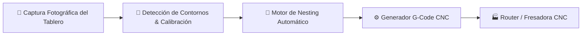

# 🪵 AutoFotoNestingNC · Sistema de Nesting CNC por Visión Artificial

> **🔒 Aviso de Propiedad Intelectual:** Este repositorio es un **Escaparate Técnico (Showcase)** para evaluación profesional y comercial. El código fuente original reside de forma privada y los clientes reciben **binarios compilados nativos (sin exposición de código)**.

---

## 🎯 ¿Qué problema resuelve?
Permite a talleres de carpintería, mueblistas y maestranzas CNC aprovechar al 100% los retazos y tableros de madera o planchas mediante fotografía directa: detecta automáticamente los contornos útiles de la plancha, calibra la escala real, optimiza el aprovechamiento (*nesting*) de piezas y exporta el **código G-Code** listo para mecanizado.

---

## 🏗️ Arquitectura del Sistema

---

## 💻 Sistemas Operativos Compatibles
* **Linux Base Debian / Ubuntu** (Debian 12+, Ubuntu 22.04/24.04+, Xubuntu, Linux Mint) — *Entorno principal optimizado*.
* **Windows 10 / 11** (Ejecutable compilado independiente).

---

## 💳 Licenciamiento Comercial y Adquisición
* **Licencia PyME (1 Estación de Trabajo · Binario Compilado):** `$120.000 – $250.000 CLP` pago único (USD `$130 – $260`).
* **Suscripción Mensual con Soporte y Actualizaciones:** `$25.000 – $45.000 CLP / mes`.
* **Pack Completo (Nesting + Catálogo Web CNC):** `$350.000 CLP` instalación + `$30.000 CLP / mes`.
* **Acceso Privado al Código Fuente (Empresas / Desarrolladores):** Cotización directa bajo licencia comercial.

📩 **Contacto para Demo / Licencias:** [correof1553@gmail.com](mailto:correof1553@gmail.com) · Autor: **Dhani Amit Elgueta Ríos (LASC Sentinel)**
